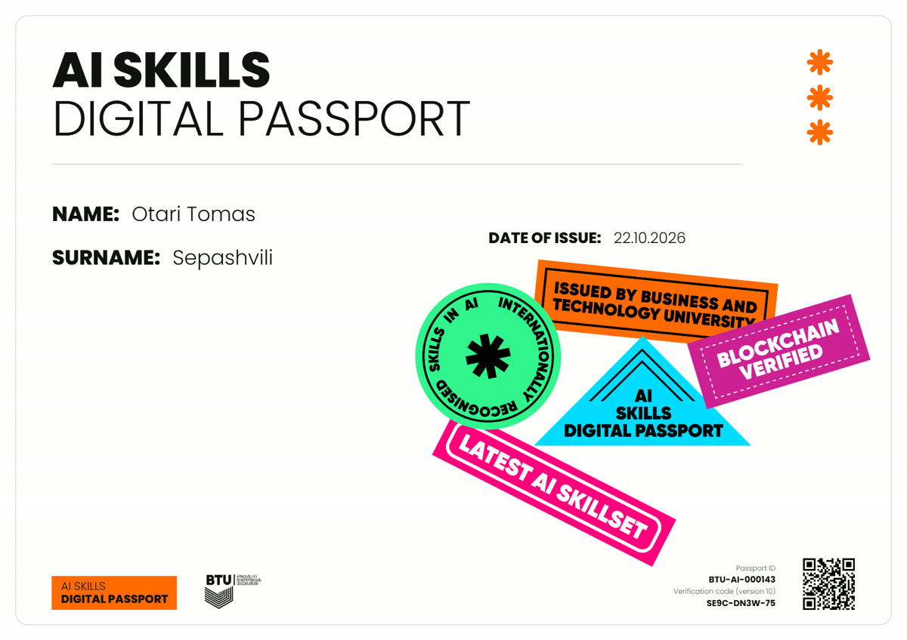
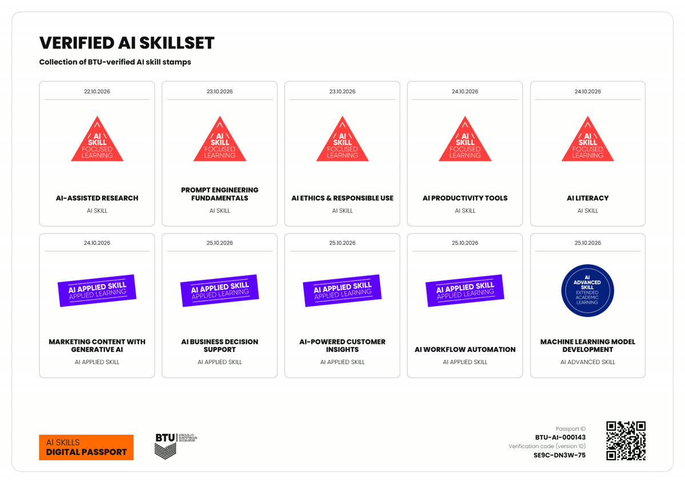
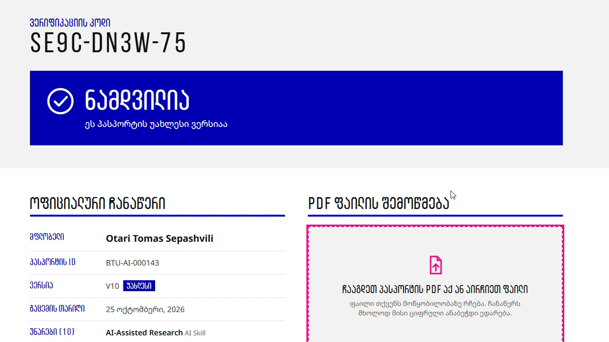
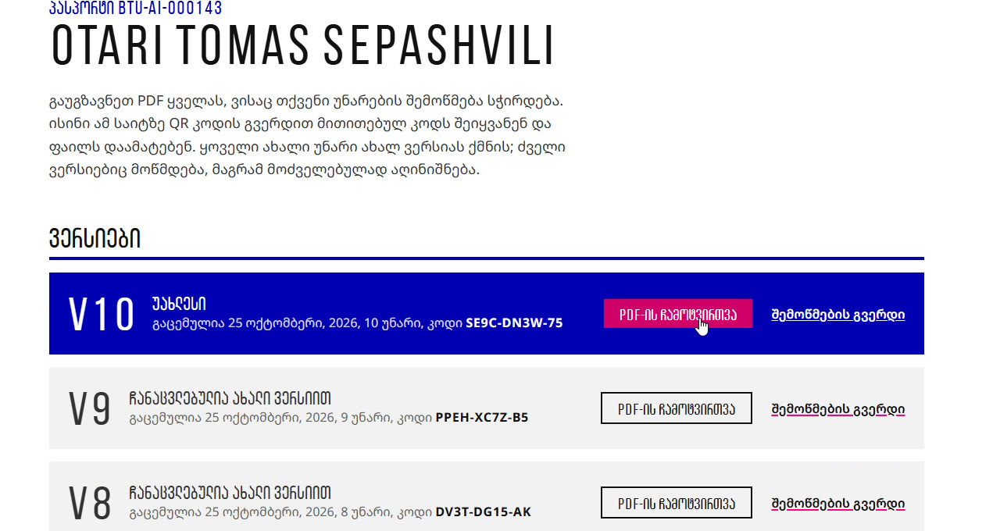
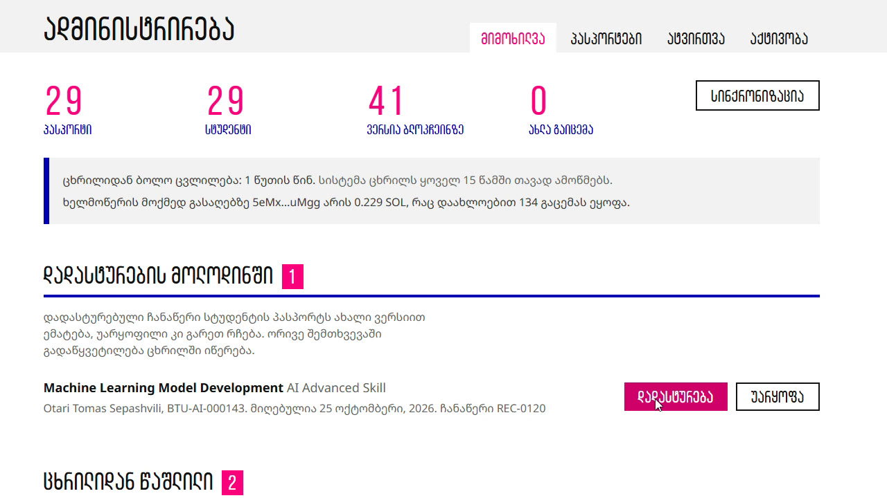
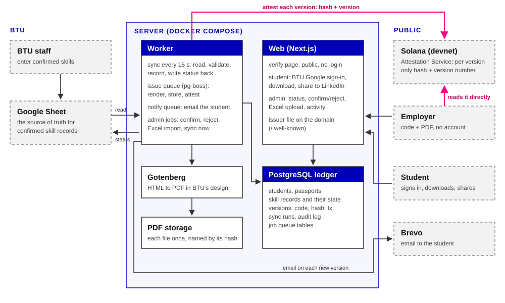

# AI უნარების ციფრული პასპორტი

[](https://github.com/600kgs/ai-skills-passport/actions/workflows/ci.yml)

**[English version](README.md)**

BTU სტუდენტის AI უნარს თავის Google ცხრილში ადასტურებს. რამდენიმე წამში სტუდენტს აქვს თავისი მრავალგვერდიანი PDF პასპორტის ახალი ვერსია BTU-ს დიზაინით, მისი ციფრული ანაბეჭდი Solana ბლოკჩეინზეა, და ნებისმიერს შეუძლია შეამოწმოს, რომ PDF ნამდვილია: ანგარიშის გარეშე და ჩვენი სერვერის ნდობის გარეშე.

აწყობილია გუნდ **Git Happens**-ის მიერ (ოთო სეფაშვილი, ნიკა ლოლიაშვილი) BTU-ს AI უნარების ციფრული პასპორტის ჰაკათონისთვის, 2026 წლის ოქტომბერი.

**სცადეთ:** სატესტო ვერსია მუშაობს მისამართზე **https://passport.btumarket.ge** (Solana devnet, სატესტო გამცემი). რეალურად გაცემული ჩანაწერი: [/v/R24Z-0RS5-R8](https://passport.btumarket.ge/v/R24Z-0RS5-R8), და იგივე ჩანაწერი [Solana Explorer-ში](https://explorer.solana.com/address/7ZtJ8CD3pacXJEDgLvwK4qhkwnWAMYjjkSvHigm6sUHB?cluster=devnet).

| პასპორტის ყდა | უნარების გვერდი |
| --- | --- |
|  |  |

| შემოწმების გვერდი (საჯარო) | სტუდენტის გვერდი | ადმინის გვერდი |
| --- | --- | --- |
|  |  |  |

## რას აკეთებს

- **BTU-ს თანამშრომლები** ისევ იმ Google ცხრილში მუშაობენ, რომელსაც უკვე იყენებენ, ან ადმინის გვერდზე Excel-ის ფაილს ტვირთავენ. ყველა რიგი მოწმდება; არასწორი რიგი პასპორტში არასდროს ხვდება და ცხრილი მიზეზს აჩვენებს.
- **სტუდენტები** ერთ მუდმივ პასპორტის ID-ს იღებენ. ყოველი დადასტურებული უნარი ახალ ვერსიას გასცემს: ახალი PDF, ახალი შემოწმების კოდი და ახალი ჩანაწერი ბლოკჩეინზე. ისინი BTU-ს Google ანგარიშით შედიან, PDF-ებს იწერენ, ყოველ ახალ ვერსიაზე მეილს იღებენ და პასპორტს LinkedIn-ზე ერთი click-ით ამატებენ.
- **დამსაქმებლები** PDF-იდან ან მისი QR კოდიდან კოდს ხსნიან და PDF-ს გვერდზე აგდებენ. ისინი ოთხიდან ერთ პასუხს იღებენ: ნამდვილია და უახლესი, ნამდვილია მაგრამ მოძველებული, შეცვლილია, ან უცნობია.

## რატომ შეიძლება პასპორტის ნდობა

სისტემის მთავარი აზრი ისაა, რომ ყალბი PDF ვლინდება, თუნდაც ჩვენი სერვერი ტყუოდეს.

1. **ამოწმებს ბრაუზერი, არა ჩვენ.** შემოწმების გვერდი ჩანაწერს პირდაპირ Solana-დან კითხულობს და PDF-ის ანაბეჭდს ადგილზე ითვლის; ფაილი არსად იტვირთება. ბრძანების ხაზის შემმოწმებელი იგივეს აკეთებს ვებსაიტის გარეშე: `pnpm --filter @passport/worker verify <file.pdf> <code>`.
2. **ჩაწერა მხოლოდ BTU-ს გასაღებს შეუძლია.** ჩანაწერები [Solana Attestation Service](https://github.com/solana-foundation/solana-attestation-service)-ის ატესტაციებია კრედენციალის ქვეშ, რომელიც BTU-ს authority გასაღებს ეკუთვნის. ეს გასაღები სერვერს არასდროს ეხება; სერვერზე მხოლოდ ყოველდღიური ხელმოწერის გასაღებია.
3. **გასაღებზე დომენი აგებს პასუხს.** საიტი HTTPS-ით აქვეყნებს [`/.well-known/btu-passport-issuer.json`](https://passport.btumarket.ge/.well-known/btu-passport-issuer.json)-ს, სადაც authority, კრედენციალი და სქემა წერია. დანერგვისას იგივე ფაილი btu.edu.ge-ზე გადავა.
4. **გაჟონილი გასაღები ნეიტრალდება.** `rotate-issuer` ახალ ხელმოწერის გასაღებს ნიშნავს და ძველს თავად ბლოკჩეინი უარყოფს (`SignerNotAuthorized`); უკვე გაცემული ყველა პასპორტი ისევ მოწმდება. ეს ცოცხალ სისტემაზე გავაკეთეთ. შემდეგ `audit-chain` აჩვენებს ყველა ჩანაწერს, რომელიც ჩვენს რეესტრში არ არის.
5. **ბლოკჩეინზე არაფერი პირადი.** ყოველ ჩანაწერში მხოლოდ PDF-ის SHA-256 და ვერსიის ნომერია.

## როგორ მუშაობს



Google ცხრილი → **worker** (სინქრონიზაცია ყოველ 15 წამში, შემოწმება, რეესტრი Postgres-ში) → PDF ერთხელ იქმნება Gotenberg-ით → ანაბეჭდი → ატესტაცია Solana-ზე → ვერსია "უახლესი" მხოლოდ ბლოკჩეინზე წარმატებული ჩაწერის შემდეგ ხდება → მეილი სტუდენტს → სტატუსი ცხრილში ბრუნდება. გაცემული PDF ერთხელ ინახება და თავიდან აღარასდროს იქმნება, რადგან ხელახლა შექმნა სხვა ბაიტებს იძლევა. დეტალები: [არქიტექტურა (ქართული)](docs/ARCHITECTURE.ka.md), [English](docs/ARCHITECTURE.md).

## დავალების სადემო სცენარები

| სცენარი | რა ხდება | სად |
| --- | --- | --- |
| ახალი სტუდენტის დამატება | ერთი პასპორტი მუდმივი ID-ით (BTU-AI-000125) | [sync.ts](apps/worker/src/sync.ts) |
| პასპორტის პირველი გენერაცია | მრავალგვერდიანი PDF BTU-ს დიზაინით; გვერდები უნარებთან ერთად მატულობს | [pdf/template.ts](apps/worker/src/pdf/template.ts) |
| ახალი დადასტურებული უნარი ცხრილში | 15 წამში აღმოჩნდება, ან მაშინვე, ადმინის გვერდიდან | [sync.ts](apps/worker/src/sync.ts), [sheet.ts](packages/core/src/sheet.ts) |
| ახალი უნარის ასახვა | სტუდენტის პასპორტი ახალ ვერსიას იღებს | [issue.ts](apps/worker/src/issue.ts) |
| განმეორებითი სინქრონიზაცია | ჩანაწერის ID ორჯერ არასდროს ემატება (უნიკალური გასაღები რეესტრში) | [ბაზის სქემა](packages/db/src) |
| არასწორი სტუდენტის იდენტიფიკატორი | რიგი FAILED-ად მოინიშნება მიზეზით; არაფერი გაიცემა | [sheet.ts](packages/core/src/sheet.ts) |
| პასპორტის განახლება | პასპორტის ID, პირველი გაცემის თარიღი და ძველი უნარები რჩება | [issue.ts](apps/worker/src/issue.ts) |
| ახალი ვერსიის გაცემა | ახალი PDF, ახალი კოდი, ახალი ატესტაცია | [issue.ts](apps/worker/src/issue.ts), [chain.ts](apps/worker/src/chain.ts) |
| უცვლელი PDF-ის შემოწმება | "ნამდვილია", ბრაუზერში ბლოკჩეინთან შედარებით | [შემოწმების გვერდი](apps/web/src/app/v/%5Bcode%5D), [chain-read.ts](packages/core/src/chain-read.ts) |
| შეცვლილი PDF-ის შემოწმება | "შეცვლილია": ერთი ბაიტის შეცვლაც კი არღვევს დამთხვევას | [verdict.ts](packages/core/src/verdict.ts) |
| გამცემის ვინაობის შემოწმება | ხელმომწერი BTU-ს კრედენციალს ეკუთვნის, რომელსაც დომენის გამცემის ფაილი ასახელებს | [გამცემის ფაილი](apps/web/src/app/.well-known/btu-passport-issuer.json/route.ts) |
| ძველი ვერსიის შემოწმება | "ნამდვილია, მაგრამ უფრო ახალი ვერსია არსებობს" | [verdict.ts](packages/core/src/verdict.ts) |
| სტუდენტის წვდომა | BTU-ს Google ანგარიშით შესვლა; თითოეული სტუდენტი მხოლოდ საკუთარ PDF-ებს ხედავს და იწერს | [me](apps/web/src/app/me/page.tsx), [PDF-ის მისამართი](apps/web/src/app/api/pdf/%5Bcode%5D/route.ts) |
| საჯარო შემოწმება | შესვლის გარეშე; კოდი ან QR ჩანაწერს ხსნის | [შემოწმების გვერდი](apps/web/src/app/v/%5Bcode%5D) |

არასავალდებულო დამატებებიდან: QR კოდი PDF-ის ყოველ გვერდზე, ადმინის პანელი (სტატუსი, მოლოდინში მყოფი უნარების დადასტურება ან უარყოფა, პასპორტები, აქტივობის ჟურნალი), Excel-ის შემოტანა წინასწარი ნახვით, მეილით შეტყობინებები, LinkedIn-ზე გაზიარება და mainnet-ის ხარჯის გეგმა (დღიური Merkle დაჯგუფება).

## გაზომილი

| რა | შედეგი |
| --- | --- |
| დადასტურების click-იდან გაცემულ ვერსიამდე, ცოცხალი სერვერი | დაახლოებით 3 წმ |
| PDF-ის შექმნა + ბლოკჩეინზე ჩაწერა | 1.6-2.5 წმ; გაცემულია 43 ვერსია, 0 ჩავარდნა |
| 5,000-რიგიანი ცხრილის სინქრონიზაცია, ახლის გარეშე | 0.39 წმ |
| 5,000 ახალი ჩანაწერის პირველი შემოტანა | 4.6 წმ, ერთხელ |
| ერთი ვერსია ბლოკჩეინზე | 0.00172212 SOL დეპოზიტი + 0.000005 SOL საკომისიო |

წელიწადში 5,000 ვერსია დღეში დაახლოებით 14-ია; ერთი worker საათში დაახლოებით 1,200 ვერსიას გასცემს. სრული ციფრები და მასშტაბირების გეგმა [არქიტექტურის დოკუმენტშია](docs/ARCHITECTURE.ka.md).

## ტექნოლოგიები

TypeScript ყველგან, ამიტომ ანაბეჭდის და ბლოკჩეინის კითხვის კოდი ერთი და იგივეა სერვერზეც და შემმოწმებლის ბრაუზერშიც. Next.js 16 (საიტი), Node worker pg-boss-ით (რიგი Postgres-ში), PostgreSQL 17 და Drizzle, Gotenberg (headless Chromium) PDF-ისთვის, `@solana/kit` + `sas-lib`, Google Sheets API service account-ით, Better Auth (მხოლოდ BTU-ს Google ანგარიშები), Brevo მეილისთვის. ეშვება Docker Compose-ით, Caddy-ს უკან, ერთ ვირტუალურ მანქანაზე; GitHub Actions ყოველ ატვირთვაზე ამოწმებს ტიპებს, lint-ს, დაახლოებით 90 ტესტს და build-ს, და ცოცხალ შემოწმებასაც: ნამდვილ გაცემულ PDF-ებს (და პიჩის ყალბ PDF-საც) საჯარო ბლოკჩეინთან ადარებს, ისე როგორც მესამე მხარე: `pnpm --filter @passport/worker test:live`.

```
apps/web        საიტი: შემოწმება, სტუდენტის გვერდი, ადმინი, გამცემის ფაილი
apps/worker     ცხრილის სინქრონიზაცია, გაცემის რიგი, PDF, ბლოკჩეინი, მეილი; scripts/ გასაღებებისა და აუდიტისთვის
packages/core   საერთო წესები: ცხრილის დამუშავება, კოდები, ანაბეჭდი, ბლოკჩეინის კითხვა, შედეგები
packages/db     სქემა და მიგრაციები
docs/           არქიტექტურა (ქართული, ინგლისური)
```

## ლოკალურად გაშვება

საჭიროა Node 24+, pnpm (`corepack enable`-ით) და Docker.

```bash
pnpm install
cp .env.example .env          # შეავსე ცხრილის id, Google OAuth და service account-ის ფაილის მისამართი
docker compose up -d          # Postgres 5433-ზე, Gotenberg 3100-ზე
pnpm --filter @passport/worker setup-issuer   # devnet გასაღებები, BTU-ს კრედენციალი და სქემა
pnpm dev                      # საიტი http://localhost:3000-ზე, worker გვერდით
pnpm test
```

პროდუქციაში გამოიყენება `docker-compose.prod.yml` (web, worker, Postgres, Gotenberg, Caddy ავტომატური HTTPS-ით).

## რეალურ დანერგვამდე

სატესტო ვერსიის გულწრფელი შეზღუდვები: მუშაობს Solana devnet-ზე, სატესტო გამცემით ჩვენს დომენზე; უკვე გაცემული უნარის გაუქმება (revocation) ჯერ არ არის აწყობილი; სარეზერვო ასლები და მონიტორინგი ჩართული არ არის, რადგან ყველა მონაცემი სატესტოა. დანერგვის გეგმა: BTU-ს საკუთარი authority გასაღები აპარატურულ საფულეზე, გამცემის ფაილი btu.edu.ge-ზე, mainnet დღიური დაჯგუფებით, სარეზერვო ასლები და შეტყობინებები, შემდეგ ეტაპობრივი გაშვება სტუდენტების ერთი ჯგუფით. იხ. [არქიტექტურის მე-8 ნაწილი](docs/ARCHITECTURE.ka.md).
