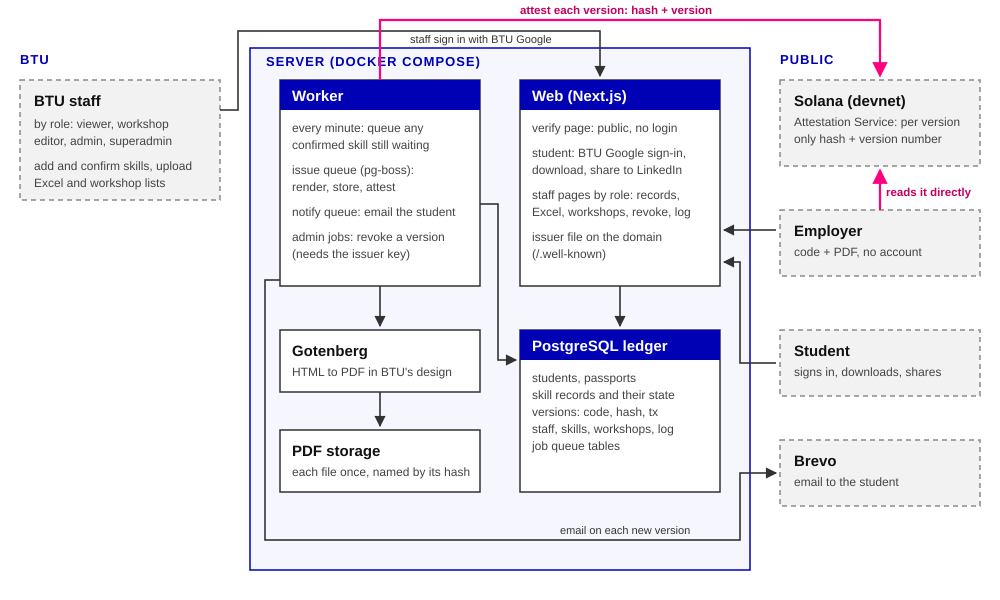

# BTU AI უნარების ციფრული პასპორტი: არქიტექტურა

[English version](ARCHITECTURE.md)

სისტემა უნარის ჩანაწერებს, რომლებსაც BTU-ს თანამშრომლები ადმინისტრირების გვერდებზე ადასტურებენ, თითოეული სტუდენტისთვის ერთ მუდმივ, ვერსიებიან PDF პასპორტად აქცევს და ყოველი ვერსიის ციფრულ ანაბეჭდს Solana-ს ბლოკჩეინზე აფიქსირებს. პასპორტის შემოწმება ნებისმიერს შეუძლია მასზე დაბეჭდილი კოდითა და თავად ფაილით, ანგარიშის გარეშე და ჩვენი სერვერისადმი ნდობის გარეშე.

სატესტო ვერსია: https://passport.btumarket.ge (Solana devnet, სატესტო გამცემი).

ორი პროცესი ერთ PostgreSQL მონაცემთა ბაზას იყენებს: **ვებ-აპლიკაცია** შემოწმებისთვის, სტუდენტებისა და BTU-ს თანამშრომლებისთვის (აქ თანამშრომლები ჩანაწერებს ამატებენ და ადასტურებენ), და **worker**, რომელიც პასპორტებს გასცემს. PDF-ებს Gotenberg ქმნის. ყველაფერი ერთ Docker Compose სტეკად მუშაობს Caddy-ს (HTTPS) უკან.

| ნაწილი | ტექნოლოგია |
|---|---|
| მონაცემების შეყვანა | ადმინისტრირების გვერდები თანამშრომლების როლებით, Excel-ის ატვირთვა და ჩამოტვირთვა, ვორქშოფების რეგისტრაციის სიები |
| Worker | Node.js 24, TypeScript, pg-boss სამუშაოების რიგი |
| რეესტრი | PostgreSQL 17 (Drizzle ORM) |
| PDF | Gotenberg 8 (Chromium), HTML/CSS შაბლონი |
| ბლოკჩეინი | Solana, Solana Attestation Service (SAS) |
| ვები | Next.js 16, Better Auth (BTU-ს Google ანგარიშები) |
| ელფოსტა | Brevo-ს ტრანზაქციული API |

## 1. მონაცემების შეყვანა, თანამშრომლების როლები და სტუდენტის იდენტიფიკაცია

**მონაცემთა ბაზა ჭეშმარიტების ერთადერთი წყაროა.** BTU-ს თანამშრომლები ჩანაწერებს საიტზე ამატებენ: სათითაოდ ჩანაწერის ფორმით, ბევრს ერთად Excel-ის ფაილით, ან ვორქშოფის სიიდან, ვინც ჩააბარა. სისტემა არასდროს წყვეტს, აქვს თუ არა სტუდენტს უნარი; ამას BTU-ს თანამშრომელი წყვეტს. (2026 წლის ნოემბრამდე ჩანაწერები Google ცხრილიდან მოდიოდა; ის რიგები რეესტრშია და უცვლელად რჩება.)

- **თანამშრომლების როლები**, თითოეული მოიცავს წინას: *მნახველი* (ყველა ადმინისტრირების გვერდს ხედავს, Excel-ს ჩამოტვირთავს), *ვორქშოფების რედაქტორი* (ვორქშოფები, რეგისტრაციის სიები, მონიშნავს, ვინ ჩააბარა), *ადმინი* (ამატებს, ასწორებს, ადასტურებს და უარყოფს ჩანაწერებს, ხსნის ნებისმიერ PDF-ს), *სუპერადმინი* (მართავს თანამშრომლებსა და როლებს, აუქმებს ვერსიებს). `ADMIN_EMAILS` პარამეტრში ჩაწერილი სუპერადმინები საიტიდან ვერ წაიშლება, ამიტომ BTU წვდომას ვერასდროს დაკარგავს. როლი ყოველ გვერდსა და მოქმედებაზე სერვერზე მოწმდება და ყოველ მოთხოვნაზე ბაზიდან იკითხება, ამიტომ ცვლილება მაშინვე მოქმედებს.
- **ყოველი ჩანაწერი მოწმდება** შენახვამდე: სტუდენტის ID, BTU-ს ელფოსტა, სტუდენტის სავალდებულო ველები, უნარი BTU-ს უნარების სიიდან, რეალური თარიღი და იგივე სახელი და ელფოსტა, რაც სტუდენტს უკვე აქვს. ჩანაწერი, რომელიც შემოწმებას ვერ გადის, არ ინახება, მიზეზი კი გვერდზე ჩანს.
- **დადასტურების სტატუსი:** ჩანაწერი `PENDING`-ია, სანამ ადმინი არ დაადასტურებს (ან მაშინვე `CONFIRMED`, თუ მას ადმინი ამატებს). პასპორტში მხოლოდ დადასტურებული ჩანაწერები ხვდება, უარყოფილი გარეთ რჩება. დამატება და დადასტურება ერთ ადამიანს შეუძლია; ყოველი გადაწყვეტილება მისი სახელით იწერება.
- **სტუდენტის ვინაობა:** სახელისა და ელფოსტის გასწორება პირველი ვერსიის გაცემამდეა შესაძლებელი, შემდეგ კი ფიქსირდება, რადგან PDF-ზე წერია. პროგრამა და საფეხური მოგვიანებითაც იცვლება.
- **ID-ებს სისტემა ანიჭებს:** Record ID (`REC-0123`) და Passport ID (`BTU-AI-000151`) ჩანაწერის ან სტუდენტის შექმნისას ენიჭება.
- **ყოველი ცვლილება ჟურნალში იწერება** თანამშრომლის ელფოსტით: ჩანაწერები, გადაწყვეტილებები, თანამშრომლები და როლები, უნარები, ვორქშოფები და გაუქმებები.

**ვორქშოფები.** თანამშრომლები საიტზე მომავალ ვორქშოფებსა და ჰაკათონებს აქვეყნებენ, თითოეულს მის უნართან და საკუთარი რეგისტრაციის ფორმის (მაგალითად Google Form) ბმულთან ერთად. ღონისძიების შემდეგ ტვირთავენ ფორმის პასუხებს, მონიშნავენ, ვინ ჩააბარა, და მონიშნული სტუდენტები ამ უნარის `PENDING` ჩანაწერს იღებენ. სისტემაში უკვე არსებული სტუდენტი BTU-ს ელფოსტით მოიძებნება და შენახულ სახელს ინარჩუნებს.

## 2. დამუშავება

თანამშრომლის ყოველი ჩაწერა ერთ ტრანზაქციაშია, იმავე ბლოკირებით, რასაც გაცემის სამუშაო იყენებს, შემდეგ კი ყოველი პასპორტისთვის, რომელსაც ახალი დადასტურებული უნარი აქვს, **გაცემის სამუშაოს** რიგში აყენებს. Worker წუთში ერთხელ ასევე ამოწმებს ყველა პასპორტს, რომელსაც დადასტურებული უნარი ჯერ კიდევ ელოდება, ამიტომ გზაში დაკარგული სამუშაოც (მაგალითად worker-ის გადატვირთვისას) შესრულდება.

გაცემის სამუშაო **ქმნის PDF-ს, ინახავს მას, მის ანაბეჭდს ბლოკჩეინზე აფიქსირებს და მხოლოდ ამის შემდეგ ნიშნავს ვერსიას გაცემულად**. ყოველი ნაბიჯი შესრულებისთანავე ინახება, ამიტომ ავარიის ან ქსელის შეცდომის შემდეგ იგივე ვერსია გრძელდება და მეორე არ იქმნება. ბლოკჩეინზე ჩაწერამდე სამუშაო ამოწმებს, ხომ არ არის ჩანაწერი უკვე იქ, ამიტომ განმეორებითი ცდა დუბლიკატს ვერ შექმნის. ვერსიის დაწყებისას უნარები იყინება და PDF ამ ასლით იქმნება; თუ PDF-ის შექმნისას უნარი შეიცვალა, უარყოფილ იქნა ან წაიშალა, დაუსრულებელი ვერსია უქმდება და თავიდან იწყება, ამიტომ გაცემის დროს შეცვლილი არაფერი ხვდება ბლოკჩეინზე. ჩავარდნილი სამუშაოები მზარდი ინტერვალით მეორდება.

ვერსიის გაცემის შემდეგ ცალკე **შეტყობინების სამუშაო** სტუდენტს წერილს უგზავნის (ქართულად და ინგლისურად, ჩამოტვირთვის ბმულით). ის ცალკე სამუშაოა, რომ ელფოსტის პრობლემამ გაცემა ვერასდროს ჩაშალოს ან გაიმეოროს. სატესტო მისამართები (`@example.org`) გამოტოვდება.

## 3. ვერსიები

- **Passport ID და პირველი გაცემის თარიღი მუდმივია.** ისინი ერთხელ, სტუდენტთან ერთად იქმნება.
- **ყოველი ცვლილება ახალ ვერსიას ქმნის** (V1, V2, ...) საკუთარი ვერიფიკაციის კოდით. ვერსიაში შემავალი ჩანაწერების სია მისი შექმნისას ფიქსირდება, ამიტომ გაცემული ვერსია ვერასდროს შეიცვლება.
- **გაცემული უნარები გაყინულია.** გაცემულ პასპორტში შემავალი ჩანაწერის შეცვლა ან წაშლა შეუძლებელია. თუ ის შეცდომა იყო, სუპერადმინი ამ ვერსიას აუქმებს (მე-5 ნაწილი) და ირჩევს, რომელი უნარები იყო მცდარი.
- **ძველი ვერსიებიც მოწმდება** და აღინიშნება როგორც „ნამდვილია, მაგრამ არსებობს უფრო ახალი ვერსია“. რეესტრი უახლეს ვერსიაზე მიუთითებს და შემოწმების გვერდი მას აჩვენებს.

## 4. PDF-ის შექმნა

პასპორტი BTU-ს დიზაინს იმეორებს: გარეკანი, „პასპორტის შესახებ“ გვერდი, შტამპების ბადე და უნარების დეტალური ცხრილი, A4 ჰორიზონტალურ ფორმატში, **BTU-ს ოფიციალური შტამპებით, სტიკერებითა და ლოგოთი**. ქართული სახელი და ტექსტი ჩაშენებული შრიფტებით იწერება. ყოველ გვერდზეა QR კოდი შემოწმების გვერდისკენ და ვერიფიკაციის კოდი.

Gotenberg (Chromium) HTML შაბლონს PDF-ად აქცევს. **ყოველი ვერსია ერთხელ იქმნება და საკუთარი SHA-256 ჰეშის სახელით ინახება.** ის აღარასდროს იქმნება თავიდან, რადგან Chromium ორჯერ ზუსტად იგივე ბაიტებს არ აწარმოებს, ბლოკჩეინზე ჩაწერილი ანაბეჭდი კი სტუდენტის მიერ ჩამოტვირთულ ფაილს ბაიტ-ბაიტ უნდა ემთხვეოდეს. შენახული ფაილი ყოველი გაცემისას თავის ჰეშთან მოწმდება.

## 5. ბლოკჩეინზე შემოწმება

**რა იწერება ბლოკჩეინზე:** ყოველი ვერსიისთვის ერთი ატესტაცია Solana Attestation Service-ში, რომელიც მხოლოდ **PDF-ის SHA-256 ჰეშსა და ვერსიის ნომერს** შეიცავს. არც სახელი, არც ელფოსტა, არც ID, არც უნარი. ატესტაციის მისამართი ვერიფიკაციის კოდიდან გამოითვლება (`sha256("btu-passport:v1:" + code)`), ამიტომ ჩანაწერის საპოვნელად მხოლოდ კოდი კმარა.

**გამცემის ვინაობა:** ატესტაციები იმ კრედენციალს ეკუთვნის, რომელიც BTU-ს **authority გასაღებს** უკავშირდება, და მათი ჩაწერა მხოლოდ authority-ის მიერ ნებადართულ გასაღებებს შეუძლია. საიტი authority-ს, კრედენციალსა და სქემას საკუთარ დომენზე აქვეყნებს: `/.well-known/btu-passport-issuer.json`. გამცემის ვინაობას დომენი ადასტურებს: ამ ტესტში ეს `passport.btumarket.ge`-ა, რეალურ სისტემაში კი btu.edu.ge-ის მისამართი იქნებოდა.

**როგორ ხდება შემოწმება:**
1. დამსაქმებელი ხსნის შემოწმების გვერდს (ან QR კოდს ასკანერებს) და PDF-ს ამატებს.
2. ბრაუზერი კითხულობს გამცემის ფაილს, შემდეგ კი ატესტაციას **პირდაპირ Solana-დან**.
3. ბრაუზერი PDF-ის ჰეშს **ადგილზე** ითვლის (ფაილი არსად იტვირთება) და მას ატესტაციაში ჩაწერილს ადარებს.
4. შედეგები: **ნამდვილია** (უახლესი ვერსია), **ნამდვილია, მაგრამ მოძველებულია**, **არ ემთხვევა** (გაცემის შემდეგ შეიცვალა, ან სხვა ფაილია) ან **უცნობი კოდი**.

ჩვენი სერვერი მხოლოდ იმას ამატებს, არის თუ არა ვერსია უახლესი. ბრძანების ხაზის შემმოწმებელი (`pnpm --filter @passport/worker verify <file.pdf> <code>`) იმავე შემოწმებას სერვერის გარეშე აკეთებს.

## 6. უსაფრთხოება

- **ორი გასაღები.** **Authority გასაღები**, რომელიც წყვეტს, ვის შეუძლია გაცემა, სერვერს არასდროს ეხება. **გამცემის გასაღები** ატესტაციებს აწერს ხელს და სერვერზე მხოლოდ worker კონტეინერის წაკითხვადი საიდუმლოს სახით არსებობს. ვებ-აპლიკაციას არცერთი გასაღები არ აქვს; საიტიდან გაუქმებას worker ასრულებს.
- **თუ გამცემის გასაღები გაჟონავს:** ერთი ბრძანება (`rotate-issuer`) ახალ გასაღებს ანიჭებს უფლებას და ძველს თავად ბლოკჩეინი უარყოფს, უკვე გაცემული ყველა პასპორტი კი მოწმდება როგორც ადრე. შემდეგ ბლოკჩეინის აუდიტი (`audit-chain`) ჩვენი კრედენციალის ქვეშ ყველა იმ ატესტაციას ჩამოთვლის, რომელიც ჩვენს რეესტრში არ არის, და შეუძლია მისი დახურვა. ის არასდროს ხურავს ჩანაწერს, რომლის PDF-იც ჩვენთან ინახება, ამიტომ ძველი სარეზერვო ასლიდან აღდგენილი ბაზაც კი ვერ გამოიწვევს ნამდვილი პასპორტების წაშლას. ორივე devnet-ზე გამოიცადა.
- **წვდომა:** სტუდენტები მხოლოდ BTU-ს Google ანგარიშებით შედიან (ამას Google ამოწმებს და ჩვენც ხელახლა) და მხოლოდ საკუთარ PDF-ებს ჩამოტვირთავენ. ადმინისტრირების გვერდები და მოქმედებები მხოლოდ როლის მქონე BTU-ს თანამშრომლებს ეკუთვნის (1-ლი ნაწილი) და ყოველი გვერდი თუ მოქმედება როლს სერვერზე ამოწმებს. თანამშრომლების ყველა მოქმედება მათი ელფოსტით იწერება ჟურნალში.
- **კონფიდენციალურობა:** საჯარო შემოწმების გვერდი მხოლოდ იმას აჩვენებს, რაც PDF-ზეა დაბეჭდილი, და მხოლოდ მას, ვისაც კოდი აქვს. კოდები 10 შემთხვევითი სიმბოლოა (დაახლოებით 50 ბიტი) და მოთხოვნები შეზღუდულია, ამიტომ სხვა სტუდენტების პასპორტების გამოცნობით პოვნა შეუძლებელია.
- **საიდუმლოები** (გასაღებები, Google-ისა და Brevo-ს მონაცემები) რეპოზიტორიაში არასდროს ხვდება.

## 7. მასშტაბირება: წელიწადში 5,000+ გაცემა და განახლება

გაზომილია 2026 წლის 24 ოქტომბერს (გაცემა: 26 ოქტომბერს). სინქრონიზაციისა და PDF-ის მონაცემები დეველოპერის კომპიუტერიდანაა (სინქრონიზაცია Google ცხრილიდან შეყვანას ეხება, რომელიც 2026 წლის ნოემბერში გაუქმდა); გაცემის დრო კი ცოცხალი სერვერიდან (Azure, 2 vCPU, 4 GB).

| რა | გაზომილი |
|---|---|
| 5,000-რიგიანი ცხრილის დამუშავება | 0.18 წმ |
| 5,000 ახალი ჩანაწერის პირველი სინქრონიზაცია (1,000 სტუდენტი) | 4.6 წმ |
| სინქრონიზაცია, როცა ახალი არაფერია | 0.39 წმ |
| სინქრონიზაცია ერთი ახალი ჩანაწერით | 0.34 წმ |
| ერთი პასპორტის შექმნა (1-დან 12 უნარამდე) | დაახლოებით 0.5 წმ, 245-285 KB |
| 8 პასპორტის ერთდროული შექმნა | ჯამში 1.7 წმ |
| დადასტურებიდან გაცემამდე / ბლოკჩეინამდე, ცოცხლად | ~3 წმ / 1.6-2.5 წმ (43 ვერსია, 0 ჩავარდნა) |
| ერთი ვერსია ბლოკჩეინზე | 0.00172212 SOL დეპოზიტი (ბრუნდება მხოლოდ დახურვით, რაც შემოწმებას წყვეტს) + 0.000005 SOL საკომისიო |
| დატვირთვის ტესტი (30 ოქტომბერი, ლოკალური საწარმოო image, ვები 2 CPU / 4 GB-ზე შეზღუდული) | შემოწმების API წამში ~700 მოთხოვნა, გვერდი წამში ~175; 1,000 ერთდროულზე 0 შეცდომა (გვერდის p95: 200-ზე 1.3 წმ, 1,000-ზე 20 წმ) |

**რას ნიშნავს წელიწადში 5,000 ვერსია:**
- **დატვირთვა:** საშუალოდ დღეში დაახლოებით 14 ვერსია. თანამშრომლის ყოველი მოქმედება ერთი პატარა ტრანზაქციაა; worker-ის წუთში ერთხელ შემოწმება ერთი მოთხოვნაა.
- **პიკები:** გაცემის სამუშაოები ამჟამად სათითაოდ სრულდება, ანუ საათში დაახლოებით 1,200 ვერსია; ერთბაშად 5,000 ვერსია (მთელი ნაკადი) დაახლოებით 4-5 საათში სრულდება, ადამიანის ჩარევის გარეშე, და რიგი გადატვირთვასაც უძლებს. სამუშაოები პასპორტების მიხედვითაა და ერთმანეთს არ ეჯახება, ამიტომ 4 პარალელური სამუშაო ამ დროს დაახლოებით ერთ საათამდე ამცირებს; Gotenberg უკვე პარალელურად მუშაობს.
- **შემოწმების ტრაფიკი:** 5,000 დამსაქმებელი ერთ წუთში წამში დაახლოებით 83 მოთხოვნაა, ანუ ტესტში გვერდის გამტარუნარიანობის ნახევარი. გვერდი ყოველ მოთხოვნაზე იქმნება და პირველი ზღვარი ისაა; ბრაუზერი ბლოკჩეინს საჯარო RPC-ით კითხულობს, არა ჩვენით. ტესტი ლოკალურად გაეშვა, არა Azure-ის სერვერზე, რომლის პროცესორი უფრო ნელია.
- **საცავი:** წელიწადში დაახლოებით 1.3 GB PDF.
- **ბლოკჩეინის ხარჯი:** წელიწადში დაახლოებით 8.6 SOL დეპოზიტებში და 0.025 SOL საკომისიოში. ძველი ვერსიები ბლოკჩეინზე უნდა დარჩეს, რომ შემოწმებადი იყოს, ამიტომ დაბლოკილი თანხა ყოველ ვერსიასთან ერთად იზრდება.

**რას შევცვლიდით და როდის:**

| შეზღუდვა | როდის იქნება მნიშვნელოვანი | ცვლილება |
|---|---|---|
| დეპოზიტი ყოველ ვერსიაზე | Mainnet-ზე, პირველივე წლიდან | **დაჯგუფება:** დღეში ერთი ატესტაცია იმ დღის ვერსიების Merkle root-ით, ყოველ PDF-ზე კი მისი მოკლე მტკიცებულება. წელიწადში დაახლოებით 365 დეპოზიტი 5,000-ის ნაცვლად (დაახლოებით 0.63 SOL). |
| გაცემა სათითაოდ | დიდი ნაკადების პიკები | worker-ის პარალელიზმის გაზრდა; Gotenberg-ის ცალკე კონტეინერში გატანა. |
| საჯარო Solana RPC-ის ლიმიტები | ნებისმიერი რეალური დატვირთვისას | **სერვერზე გაკეთებულია (26 ოქტომბერი):** პროვაიდერის გასაღებით; ბრაუზერები საჯარო მისამართს იყენებენ, ჩვენს გასაღებს არა. |
| PDF-ები სერვერის დისკზე | დანერგვისას | ობიექტური საცავი (Azure Blob) სარეზერვო ასლებით. |

## 8. რეალური დანერგვისთვის

ტესტისთვის აწყობილი სისტემის დასრულებისთვის საჭიროა:
- **Authority გასაღები BTU-ს ხელშია** აპარატურულ საფულეზე ან multisig-ზე, რომ BTU-ს გარდა ვერავინ შეძლოს გამცემების დანიშვნა.
- **Mainnet და BTU-ს დომენი** (მაგალითად `passport.btu.edu.ge`) BTU-ს საკუთარი authority გასაღებით; პასპორტები მისი სახელით გაიცემა.
- **სარეზერვო ასლები:** ბაზის ყოველსაათობრივი ასლები და PDF-ები Azure Blob-ში რბილი წაშლით, აღდგენის გამოცდილი პროცედურით.
- **მონიტორინგი:** ხელმისაწვდომობის შემოწმება და შეტყობინებები ჩავარდნილ გაცემებზე, ხელმოწერის გასაღების დაბალ ბალანსზე და ბლოკჩეინის ყოველსაათობრივ აუდიტზე.
- **გაუქმება (გაკეთდა, 2026 წლის ნოემბერი):** სუპერადმინი ვერსიას მისი პასპორტის გვერდიდან აუქმებს და მონიშნავს, რომელი უნარები იყო შეცდომა. ბლოკჩეინზე ჩანაწერი იხურება, შემოწმების გვერდი ვერსიას გაუქმებულად აჩვენებს მიზეზით, მცდარი უნარები სამუდამოდ ამოიღება, სტუდენტი კი დანარჩენით ავტომატურად იღებს გასწორებულ ვერსიას.
