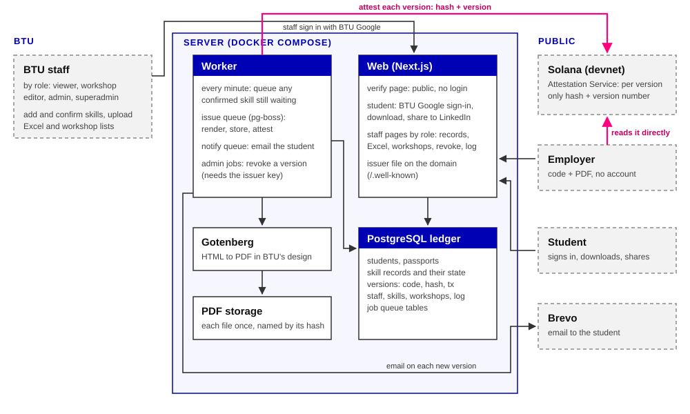

# BTU AI Skills Digital Passport: architecture

[ქართული ვერსია](ARCHITECTURE.ka.md)

The system turns skill records that BTU staff confirm on its admin pages into one permanent, versioned PDF passport per student, and records a fingerprint of every version on the Solana blockchain. Anyone can check a passport with the code printed on it and the file itself, without an account and without trusting our server.

Live test deployment: https://passport.btumarket.ge (Solana devnet, test issuer).

Two processes share one PostgreSQL database: a **web app** for verification, students and BTU staff (where staff enter and confirm records), and a **worker** that issues passports. Gotenberg renders the PDFs. Everything runs as one Docker Compose stack behind Caddy (HTTPS).

| Part | Technology |
|---|---|
| Data entry | Admin pages with staff roles, Excel upload and download, workshop registration lists |
| Worker | Node.js 24, TypeScript, pg-boss job queue |
| Ledger | PostgreSQL 17 (Drizzle ORM) |
| PDF | Gotenberg 8 (Chromium), HTML/CSS template |
| Blockchain | Solana, Solana Attestation Service (SAS) |
| Web | Next.js 16, Better Auth (BTU Google accounts) |
| Email | Brevo transactional API |

## 1. Data entry, staff roles and student identification

**The database is the single source of truth.** BTU staff add records on the website: one at a time with the record form, many at once from an Excel file, or from a workshop's list of who passed. The system never decides whether a student has a skill; a person at BTU does. (Until November 2026 records came from a Google Sheet; those rows are in the ledger and stay as they are.)

- **Staff roles**, each including the ones before it: *viewer* (reads every admin page, downloads Excel), *workshop editor* (workshops, registration lists, ticks who passed), *admin* (adds, edits, confirms and rejects records, opens any PDF), *superadmin* (manages staff and roles, revokes versions). The `ADMIN_EMAILS` setting lists superadmins that can't be removed on the website, so nobody can lock BTU out. The role is checked on the server for every page and every action, and read from the database on every request, so a change applies at once.
- **Every record is checked** before it is saved: a real student ID, a BTU email, the required student fields, a skill from BTU's skill list, a real date, and the same name and email as the student already has. A record that fails is not saved, and the reason is shown on the page.
- **Verification status:** a record is `PENDING` until an admin confirms it (or `CONFIRMED` at once when an admin adds it). Only confirmed records go into a passport; rejected ones are kept out. One person may add and confirm; every decision is logged with their name.
- **Student identity:** a student's name and email can be corrected until their first version is issued, then they are fixed, because the PDF carries them. Program and level can change later.
- **IDs come from the system:** Record IDs (`REC-0123`) and Passport IDs (`BTU-AI-000151`) are assigned when a record or a student is created.
- **Every change is logged** with the staff member's email: records, decisions, staff and role changes, skills, workshops and revokes.

**Workshops.** Staff list upcoming workshops and hackathons on the site, each with the skill it gives and a link to its own registration form (for example a Google Form). After the event they upload the form's export, tick who passed, and the ticked students get `PENDING` records for that skill. A student who is already in the system is matched by BTU email and keeps their stored name.

## 2. Processing

Every write by staff runs in one database transaction under the same lock the issue job takes, then queues an **issue job** for each passport that has newly confirmed skills. Once a minute the worker also queues every passport that still has a confirmed skill waiting, so a job lost on the way (for example while the worker restarted) still runs.

An issue job **renders the PDF, stores it, records its fingerprint on chain, and only then marks the version issued**. Each step is saved as it happens, so a crash or a failed network call resumes the same version instead of starting a second one. Before writing to the chain the job checks whether the record is already there, so a retry can't create a duplicate. The skills are frozen when a version opens and the PDF is made from that copy; if a skill is edited, rejected or deleted while the PDF renders, the unfinished version is dropped and started again, so nothing changed mid-issue reaches the chain. Failed jobs retry with growing delays.

After a version is issued, a separate **notify job** emails the student (Georgian and English, with a download link). It is its own job so that an email problem can never fail or repeat an issue. Test addresses (`@example.org`) are skipped.

## 3. Versioning

- **Passport ID and first-issue date are permanent.** They are created once, with the student.
- **Every change creates a new version** (V1, V2, ...) with its own verification code. A version's list of included records is fixed when it is created, so an issued version can never change.
- **Issued skills are frozen.** A record that is in an issued passport can't be edited or deleted. If it was a mistake, a superadmin revokes that version (section 5) and chooses which skills were wrong.
- **Old versions keep verifying**, marked "authentic, but a newer version exists". The ledger points to the latest version, and the verify page shows it.

## 4. PDF generation

The passport reproduces BTU's design: the cover, the "about" page, a stamp grid and a detailed skills table, in A4 landscape, using **BTU's official stamps, stickers and logo**. The Georgian name and text are embedded as fonts. Every page carries a QR code to its verify page and the verification code.

Gotenberg (Chromium) turns the HTML template into a PDF. **Each version is rendered once and stored under its own SHA-256 hash.** It is never rendered again, because Chromium doesn't produce byte-identical output twice, and the on-chain fingerprint must match the file the student downloads, byte for byte. A stored file is checked against its hash every time it is served.

## 5. Blockchain verification

**What goes on chain:** for each version, one attestation in the Solana Attestation Service holding only the **SHA-256 hash of the PDF and the version number**. No name, email, ID or skill. The attestation's address is derived from the verification code (`sha256("btu-passport:v1:" + code)`), so the code alone finds the record.

**Issuer identity:** attestations live under a credential that belongs to BTU's **authority key**, and only keys the authority has authorized can write them. The site publishes the authority, credential and schema at `/.well-known/btu-passport-issuer.json` on its own domain. The domain is what vouches for the issuer: in this test it is `passport.btumarket.ge`; in production it would be a btu.edu.ge address.

**How a check works:**
1. The employer opens the verify page (or scans the QR) and adds the PDF.
2. The browser reads the issuer file, then reads the attestation **directly from Solana**.
3. The browser hashes the PDF **locally** (the file is never uploaded) and compares the hash with the attested one.
4. Results: **authentic** (latest version), **authentic but outdated**, **doesn't match** (changed after issue, or a different file), or **unknown code**.

Our server only adds whether a version is the latest. A command-line verifier (`pnpm --filter @passport/worker verify <file.pdf> <code>`) does the same check with no server at all.

## 6. Security

- **Two keys.** The **authority key**, which decides who may issue, never touches the server. The **issuer key** signs attestations and lives on the server only as a read-only secret of the worker container. The web app has neither key; a revoke from the website is carried out by the worker.
- **If the issuer key leaks:** one command (`rotate-issuer`) authorizes a new key and makes the chain itself reject the old one, while every passport already issued keeps verifying. A chain audit (`audit-chain`) then lists any attestation under our credential that our ledger doesn't know, and can close it. It never closes a record whose PDF we hold, so even a database restored from an old backup can't lead to deleting real passports. Both were exercised on devnet.
- **Access:** students sign in with BTU Google accounts only (checked by Google and again on our side) and can download only their own PDFs. Admin pages and actions are limited to BTU staff with a role (section 1), and every page and action checks the role on the server. All staff actions are logged with their email.
- **Privacy:** the public verify page shows only what is printed on the PDF, and only to someone who has the code. Codes are 10 random characters (about 50 bits) and lookups are rate-limited, so other students' passports can't be found by guessing.
- **Secrets** (keys, Google and Brevo credentials) are never in the repository.

## 7. Scalability: 5,000+ issues and updates a year

Measured on 24 October 2026, live issue figures updated 26 October. Sync and PDF figures come from a developer PC (the sync figures are from the Google Sheet input, retired in November 2026); issue time comes from the live server (Azure, 2 vCPU, 4 GB).

| What | Measured |
|---|---|
| Parse a 5,000-row sheet | 0.18 s |
| First sync of 5,000 new records (1,000 students) | 4.6 s |
| Sync with nothing new | 0.39 s |
| Sync with one new record | 0.34 s |
| Render one passport (1 to 12 skills) | about 0.5 s, 245 to 285 KB |
| Render 8 passports at once | 1.7 s in total |
| Confirm click to issued version / to chain only, live | about 3 s / 1.6 to 2.5 s (43 versions, 0 failed) |
| One version on chain | 0.00172212 SOL deposit (back only by closing the record, which ends its verification) + 0.000005 SOL fee |
| Load test (30 October, local production image, web capped to 2 CPU / 4 GB) | verify API about 700 req/s, verify page about 175 req/s; 0 errors at 1,000 concurrent (page p95 1.3 s at 200, 20 s at 1,000) |

**What 5,000 versions a year means:**
- **Load:** about 14 versions a day on average. Each staff action is one small database transaction; the worker's once-a-minute check for waiting skills is a single query.
- **Bursts:** issue jobs run one at a time today, so about 1,200 versions an hour; a burst of 5,000 at once (a whole cohort) finishes in about 4 to 5 hours, unattended, and the queue survives restarts. Jobs are per passport and never conflict, so running 4 in parallel cuts that to roughly an hour; Gotenberg already renders in parallel.
- **Verify traffic:** 5,000 employers within one minute is about 83 requests a second, half of what the page handled in the load test. The page is rendered per request and is the first limit; the browser's chain read goes to a public RPC, not to us. The test ran locally, not on the Azure VM, whose cores are slower.
- **Storage:** about 1.3 GB of PDFs a year.
- **Chain cost:** about 8.6 SOL a year locked in deposits plus 0.025 SOL in fees. Old versions must stay on chain to keep verifying, so the locked amount grows with every version.

**What we would change, and when:**

| Limit | When it matters | Change |
|---|---|---|
| Deposit per version | Mainnet, from the first year | **Batch:** one attestation per day holding a Merkle root of that day's versions, with each PDF carrying its short proof. About 365 deposits a year instead of 5,000 (about 0.63 SOL). |
| One issue at a time | Large cohort bursts | Raise the worker's parallelism; split Gotenberg onto its own container. |
| Public Solana RPC rate limits | Any real load | **Done for the server (26 October):** a keyed provider endpoint; browsers keep a keyless one from the issuer file, so verification never depends on our key. |
| PDF storage on the server disk | Rollout | Object storage (Azure Blob) with backups. |

## 8. For a real rollout

Built for the test, still to do for production:
- **BTU holds the authority key** on a hardware wallet or a multisig, so nobody outside BTU can authorize issuers.
- **Mainnet and a BTU domain** (for example `passport.btu.edu.ge`), with BTU's own authority key; passports are issued under it.
- **Backups:** hourly database dumps and PDF copies to Azure Blob with soft delete, plus a tested restore.
- **Monitoring:** an uptime check, and alerts for failed issues, a low signing-key balance, and an hourly chain audit.
- **Revocation (done, November 2026):** a superadmin revokes a version from its passport page and ticks the skills that were the mistake. The chain record is closed, the verify page shows the version as revoked with the reason, the wrong skills are withdrawn for good, and the student automatically gets a corrected version with the rest.
